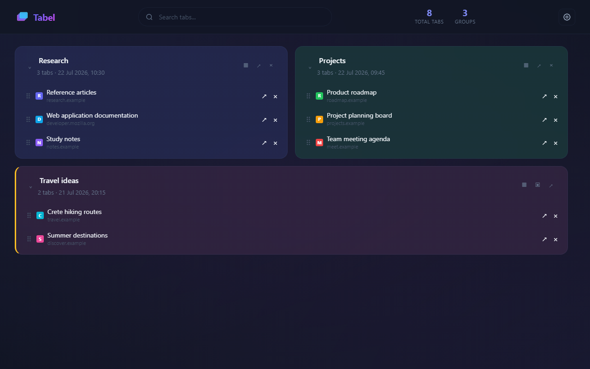
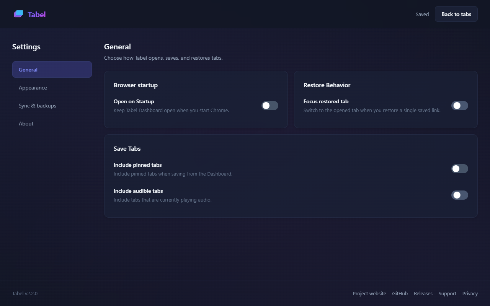

# Tabel

Tabel is a Chrome extension that saves and organizes open tabs into visual groups.

Version 2.2.0 is available on the Chrome Web Store and GitHub. Manifest V3. English interface.

[Add to Chrome](https://chromewebstore.google.com/detail/tabel-tab-manager/hmdklfckhfiobokdglandjdndgaefngd) | [Official website](https://kyriakosgian.github.io/Tabel/) | [Report a problem](https://github.com/KyriakosGian/Tabel/issues) | [Releases](https://github.com/KyriakosGian/Tabel/releases)





## Features

- Organize Settings into General, Appearance, Sync & backups, and About, using the Dashboard visual foundation.
- Find project, GitHub, release, support, and privacy links in the Settings footer.
- Protect imported collections against stale uploads from another device.
- Confirm receipt from another updated device and review both copies before recovery.
- Save non-pinned tabs from the active window.
- Save the most recently active eligible tab, selected open tabs, or eligible tabs from every window, then close them after successful persistence.
- Add captured tabs to the top of an existing unlocked group.
- Save a page or link from the Chrome context menu and send a link to a new or existing group.
- Keep only the newest saved copy when the same URL is captured again.
- Restore one tab or a complete group.
- Search, rename, delete, sort, and move groups and tabs.
- Hide tab URLs or show a domain or complete address.
- Customize density, font size, favicon size, default group width, and group layout.
- Use System, Light, or Dark theme with a live appearance preview.
- Choose Local Only or Chrome Sync.
- View separate upload/download timestamps, pending changes, storage use, and deletion history.
- Clean unused sync data, safely reset the cloud, or clear old Chrome Sync storage while keeping local links.
- Protect Delete All with typed confirmation and verified local safety backups, and restore the last backup.
- Import and export JSON backups.

## Installation

Install Tabel for free from the [Chrome Web Store](https://chromewebstore.google.com/detail/tabel-tab-manager/hmdklfckhfiobokdglandjdndgaefngd). Select **Add to Chrome** and confirm the installation. Developer mode is not required.

## Development

Local installation is intended for development and testing.

1. Clone this repository or download and extract a package from [GitHub Releases](https://github.com/KyriakosGian/Tabel/releases).
2. Open `chrome://extensions/` in Chrome and enable Developer mode.
3. Select Load unpacked and choose the directory containing `manifest.json`.
4. After editing the code, reload the extension from `chrome://extensions/`.

### Tests

Node.js 22 or later is required.

```bash
npm test
```

The test suite uses the built-in `node:test` runner and requires no third-party packages.

## Optional synchronization validation

Build the isolated test package with `./scripts/build-release.ps1 -TestBuild`. Load the same test ZIP as an unpacked extension on both computers. Its stable test ID and the name Tabel Sync Test keep it separate from the Store installation. Import a backup on one test installation only, confirm the saved links arrive on the second, then rename a group on the second and check the return change. Do not reset or clear either copy during this test. Do not upload the test ZIP to the Store.

## Public release

- `docs/` contains the GitHub Pages website, privacy policy, and support page.
- `release/` contains the Chrome Web Store copy, graphic assets, and release notes.
- `npm run build:release` creates a clean Chrome Web Store ZIP in `dist/`.
- GitHub Actions runs the test suite for every push and pull request.
- Pushing a new version tag creates a GitHub Release and attaches the Store ZIP.

## Create a release

For a future extension update, first set a new version in `manifest.json` and `package.json` and update the changelog and release notes. Run these checks in PowerShell on Windows:

```powershell
npm test
npm run build:release
```

Commit and push the changes, then create and push a new Git tag with `v` followed by that version. Do not reuse an existing release tag. Documentation-only changes do not require a version change, a new tag, or a new Store package.

## Project structure

```text
Tabel/
|-- background.js
|-- manifest.json
|-- dashboard/
|-- options/
|-- styles/
|-- icons/
|-- _locales/
|-- docs/
|-- release/
|-- scripts/
`-- tests/
```

## Data storage

- IndexedDB stores groups, tabs, deletion records, and up to five verified local safety backups, with a 50 MiB total backup budget. Export a JSON file for a backup that survives uninstalling the extension.
- `chrome.storage.local` stores settings, privacy consent, sync status, a context-menu group index, and crash-safe pending capture data.
- `chrome.storage.sync` synchronizes saved groups between installations with the same extension ID and Google Account when Chrome sync is enabled.
- Upload and download timestamps report operations on this device. They do not confirm receipt by another device. An upload failure remains visible after a successful download.
- Chrome sync provides approximately 100 KB for saved data, deletion records, and sync metadata. Settings shows quota usage. Tabs remain local if a sync write fails.
- Website icons are rendered through Chrome's favicon API and are not stored or synchronized.
- Chrome snapshots include SHA-256 verification. Tabel does not add application-level password encryption.
- Deletion records remain for at least 90 days and until all known devices acknowledge them. New captures of an existing URL preserve its identifier instead of creating another deletion record.
- Cloud resets create a new collection generation. Old 2.1 devices must explicitly rejoin. Update or stop every 2.0 installation before resetting or clearing Chrome Sync, since 2.0 does not understand reset generations.
- Clearing Chrome Sync pauses an active Chrome provider and retains a small empty reset marker. It does not delete local links or other extensions' data.
- Automatic background checks run every five minutes while Chrome is running. Failed network/rate requests retry with backoff.
- The public manifest key identifies the extension. It is not a password or a credential for accessing another user's data.

## Browser validation

`npm test` runs the dependency-free regression suite. `npm run test:ui` requires Playwright and the installed Chrome browser and checks navigation, preference saving, confirmations, real IndexedDB backups, and Chrome cloud recovery with synthetic data. `npm run test:extension` loads the real extension in a temporary unsigned-in Chrome profile and checks database migration, native Chrome storage, alarms, and recovery. `TABEL_PLAYWRIGHT_PATH` can point to an existing Playwright package. Neither browser check downloads a browser or uses a personal Chrome profile.

## License

Tabel is released under the [MIT License](LICENSE).
